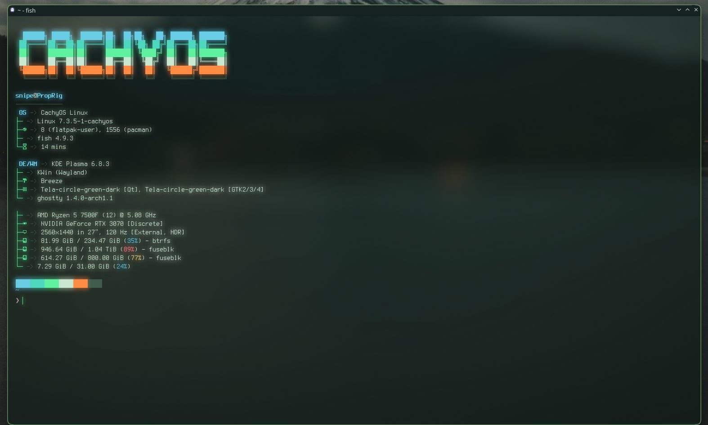
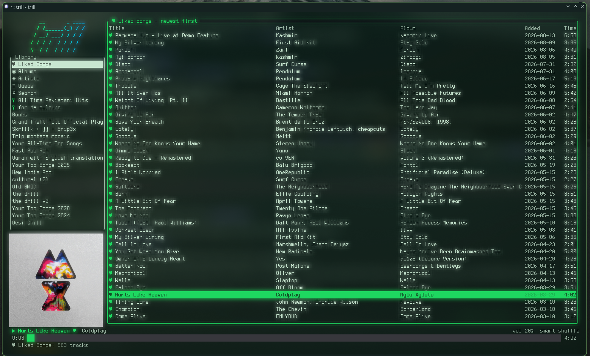

<div align="center">

# ▓▒░ ghostty-glow ░▒▓

**Retro CRT phosphor bloom for [Ghostty](https://ghostty.org).**

*Every colour glows, the way it did on an old CRT monitor.*

</div>

Remember how text looked on an old CRT? The phosphor glowed. Light bled softly
off every character and hung in the dark around it. Green, amber, cyan: they
all glowed the same.

`ghostty-glow` brings that back to Ghostty without scanlines, flicker or grain.
You just get a soft bloom around your text.

**What's different:** most bloom shaders choose what glows by *luma*, which is
how bright a colour looks to your eye. Greens and whites score high, so they
glow. Blues, reds and oranges score low and barely glow, even at full brightness.
This shader looks at each colour's **brightest channel** instead and boosts the
glow to full strength, so every colour glows evenly. Only black and dark greys
stay unlit.





<sub>Both shots use the optional Glow Forest theme with `background-opacity = 0.40` and `background-blur = 30`.</sub>

## Features

- Even glow for every hue: blue, orange and red glow as much as green and white
- Smooth Gaussian falloff with no grain or banding
- Letters stay crisp; the glow is only added *around* glyphs
- Works with transparent / blurred backgrounds (`background-opacity`)
- Static, so no animation loop or idle GPU usage (`custom-shader-animation = false` is fine)
- Optional matching **Glow Forest** colour theme

## Install

### One command

```sh
curl -fsSL https://raw.githubusercontent.com/Snip3x/ghostty-glow/main/install.sh | sh
```

Want the matching green theme too?

```sh
curl -fsSL https://raw.githubusercontent.com/Snip3x/ghostty-glow/main/install.sh | sh -s -- --theme
```

Then reload Ghostty (`ctrl+shift+,`) or open a new window. That's it.

The script:
- copies the shader to `~/.config/ghostty/shaders/glow.glsl`
- backs up your config to `config.bak-ghostty-glow`
- adds a `custom-shader = ...` line to your config
- if it is already installed, asks whether to update, revert or cancel
- with `--theme`, installs `glow-forest` and adds `theme = glow-forest`

It works on Linux and macOS (any POSIX `sh`, needs `curl` or `wget`).

### From a clone

```sh
git clone https://github.com/Snip3x/ghostty-glow
cd ghostty-glow
./install.sh            # or: ./install.sh --theme
```

### Manual

1. Download [`shaders/glow.glsl`](shaders/glow.glsl) and save it anywhere, e.g. `~/.config/ghostty/shaders/glow.glsl`.
2. Add this line to your Ghostty config (`~/.config/ghostty/config` or `config.ghostty`), using the full path:
   ```ini
   custom-shader = /home/you/.config/ghostty/shaders/glow.glsl
   ```
3. Reload Ghostty (`ctrl+shift+,`).

## Update or revert

Run the same install command again. It sees that ghostty-glow is already installed and asks:

```
  ▓▒░ ghostty-glow ░▒▓

  > ghostty-glow is already installed

  [u] update to latest   [r] revert (uninstall)   [c] cancel
  choice [u]:
```

- **Update** gets the latest shader (and theme, if you installed it). If you tweaked
  your shader, your version is saved as `glow.glsl.bak` first, so your settings aren't lost.
- **Revert** removes the shader, the theme and the glow lines from your config. Your
  other settings and any other shaders stay as they are.
- **Cancel** changes nothing.

Skip the question with flags:

```sh
curl -fsSL https://raw.githubusercontent.com/Snip3x/ghostty-glow/main/install.sh | sh -s -- --update
curl -fsSL https://raw.githubusercontent.com/Snip3x/ghostty-glow/main/install.sh | sh -s -- --revert
```

## Tuning

Edit the constants at the top of `glow.glsl`:

| Constant   | Default | What it does |
|------------|---------|--------------|
| `STRENGTH` | `0.20`  | Glow intensity. `0.15` is subtle, `0.4` and up is very bright. |
| `SPREAD`   | `1.7`   | How far the glow reaches (pixels between samples). |
| `LOW`      | `0.40`  | Colours dimmer than this don't glow. Lower it to make greys glow too. |
| `HIGH`     | `0.65`  | Colours at or above this get full glow. |
| `R`        | `8`     | Blur radius in samples. Lower (e.g. `5`) is cheaper on weak GPUs. |

The glow fades out evenly from the text. To make the fade tighter or looser, change
the `sigma` multiplier (`0.35`) in `mainImage`.

## Performance

The blur samples a `(2R+1)²` grid (289 samples at `R = 8`) per pixel. That's
trivial for any discrete GPU. On integrated graphics with a large window, drop `R`
to 5 or 6.

## License

MIT
